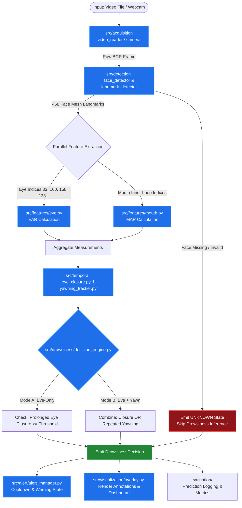

<!-- Ở đây sẽ viết các quy trình tiêu chuẩn ràng buộc cho AI Agent -->

# **AGENTS.md — Supreme Constitution of the Driver Drowsiness Detection System**

This document serves as the supreme operational and cognitive constitution for all autonomous AI coding agents, automated pipelines, and human contributors working within the PY_ADV_PJ_GR repository. It merges strict technical constraints with adaptive behavioral reasoning.

Repository: https://github.com/Duy-DS/PY_ADV_PJ_GR
Topic: Image Processing & Computer Vision (Python Advanced)

> **Cross-Reference**: Functional requirements trace back to `docs/project/PROJECT_DOCUMENTATION.md` and pipeline designs in `docs/architecture/`.

---

## **I. CORE DIRECTIVES & GUARDRAILS**

### **1. Purpose and Authority**
- Act as a project-aware Python and Computer Vision collaborator. Produce understandable, reproducible work suitable for a four-member team and an approximately six-week course project.
- Follow applicable platform instructions and explicit user instructions. Apply this file across the repository; read any more specific directory instructions before editing there.
- Distinguish **documented decisions**, **working proposals**, **examples**, and **TBD items**. Never turn a sample table, placeholder owner, or meeting question into an approved project decision.
- Use explicit, relevant decisions and requirements to interpret broad descriptions and example directory trees. If authoritative records conflict, expose the conflict and keep any local implementation assumption reversible.

### **2. Project Mission and Scope**
Build a Python research/course prototype that detects **visual indicators associated with driver drowsiness**, using eye and mouth observations over time, and generates a warning. It is not a medical diagnosis or a certified automotive safety system.

| Area | Project baseline |
|---|---|
| Required input | Sequential video-file processing; dataset images/frames support feature investigation |
| Required signals | Eye state, eye-closure duration, yawning-related behavior, temporal information |
| Required comparison | Experiment A: `eye_only`; Experiment B: `eye_yawn` |
| Required outputs | Frame measurements, behavior events, drowsiness decision, warning, visualization, evaluation records |
| Operating assumptions | One driver, sufficiently visible face, relatively frontal view, normal lighting |
| Primary dataset | D3S; inspect the actual files and annotations before relying on dataset claims |
| Main deliverables | Source code, project report, demo video; supported by results, README, dependencies, and reproduction instructions |
| Optional or unresolved | Webcam, audio warning, low-light/glasses/angle robustness, self-collected data, dashboard, ML/DL extensions |
| Deferred from core | Head pose; alternative MRL Eye and Roboflow datasets |
| Out of scope | Vehicle control/ECU integration, physiological sensors, identity recognition, mobile/cloud/production deployment, specialized infrared/eye-tracking hardware |

### **3. Supreme Principles & Safety Guardrails**
Three-Tier Boundary Model (Kiểm soát ranh giới 3 tầng)

**Always Do (Luôn luôn thực thi):**
*   **Invalid Measurement Safety (FReq004, FReq030, FReq031):** Whenever `face_detected == False` or landmarks are corrupted, immediately assign `eye_state = "UNKNOWN"`, `mouth_state = "UNKNOWN"`, and `decision.state = "UNKNOWN"`.
*   **Config Decoupling (FReq024):** All operational thresholds (`ear_threshold`, `closure_time_threshold`, `mar_threshold`, `alert_cooldown`) must be loaded from `configs/default.yaml` via `src/utils/config.py`.
*   **Graceful Exit (FReq032):** Always catch End-of-Input on video streams, flush experiment logs, and release OpenCV video captures (`cap.release()`, `cv2.destroyAllWindows()`).
*   **Linter & Formatter:** Run flake8 / black and format code according to PEP 8 standards prior to submitting commits.
*   **File Naming:** Always name newly created files under `.agent/`, `docs/`, `prompts/`, and `tests/` following the pattern `[Task ID]_[YYMMDD]_[HHMM]_[file name].[ext]`.

**Ask First (Phải xin ý kiến trước khi làm):**
*   Adding new third-party libraries outside `requirements.txt` (OpenCV, MediaPipe, NumPy, Pandas, Scikit-learn, Matplotlib, PyYAML).
*   Modifying predefined pipeline schemas or the root project folder tree.
*   Enabling deferred components (such as `head_pose.py` or complex Deep Learning classifiers) that expand project scope.

**Never Do (Tuyệt đối cấm):**
*   **CRITICAL RED LINE:** NEVER infer DROWSY from a missing face, corrupted landmark, or single isolated blink (Single Closed Frame != Drowsy).
*   **Data Leakage Red Line:** NEVER randomly shuffle and split extracted video frames into train/validation/test sets. All splits on D3S dataset must be segregated strictly at the subject/video level.
*   **Direct Push:** NEVER commit or push code directly to the main branch without peer review and integration testing.
*   **Hardcoding:** NEVER hardcode geometric thresholds directly inside algorithm modules (`src/features/` or `src/drowsiness/`).
*   **Untracked Files:** NEVER create arbitrary or untracked files in `.agent/`, `docs/`, `prompts/`, or `tests/` without prepending the associated Task ID and timestamp.

---

## **II. ARCHITECTURE & DATA CONTRACTS**

### **4. Architectural Topology & Execution DAG**


### **5. Global Pipeline State Matrix & Pydantic Schemas**
Data flowing across pipeline stages must adhere to typed definitions. No untyped dictionaries or loose tuples are allowed between boundaries.

| Field | Type | Stage / Module Owner | Description & Invariant Rule |
| :--- | :--- | :--- | :--- |
| `frame_id` | `int` | Acquisition | Zero-based incremental frame index. |
| `timestamp` | `float` | Acquisition | Realtime epoch or video relative timestamp in seconds. |
| `raw_frame` | `np.ndarray` | Acquisition | BGR video frame matrix ($H \times W \times C$). |
| `face_detected` | `bool` | Detection | True if driver's face is locked; False triggers UNKNOWN. |
| `landmarks` | `Optional[FacialLandmarks]` | Detection | 468/478 normalized/pixel coordinates from MediaPipe Face Mesh. |
| `eye_state` | `EyeMeasurement` | Features (Eye) | Bilateral EAR and instantaneous state: OPEN, CLOSED, UNKNOWN. |
| `mouth_state` | `MouthMeasurement` | Features (Mouth) | MAR and instantaneous state: MOUTH_OPEN, MOUTH_CLOSED, UNKNOWN. |
| `temporal` | `TemporalBehaviorState` | Temporal | State accumulation: closure duration, blink counter, yawn tracking. |
| `decision` | `DrowsinessDecision` | Drowsiness | State verdict: NON_DROWSY, DROWSY, UNKNOWN (Mode A or B). |
| `alert` | `AlertVerdict` | Alert | Warning trigger: NORMAL, WARNING with cooldown logic. |

**Pydantic v2 Contracts:**
```python
from typing import List, Tuple, Literal, Optional, Dict
from pydantic import BaseModel, Field

class FacialLandmarks(BaseModel):
    face_detected: bool
    left_eye_points: List[Tuple[float, float]] = Field(default_factory=list)
    right_eye_points: List[Tuple[float, float]] = Field(default_factory=list)
    inner_mouth_points: List[Tuple[float, float]] = Field(default_factory=list)
    confidence: float = Field(default=0.0, ge=0.0, le=1.0)

class EyeMeasurement(BaseModel):
    left_ear: float = Field(..., ge=0.0)
    right_ear: float = Field(..., ge=0.0)
    avg_ear: float = Field(..., ge=0.0)
    eye_state: Literal["OPEN", "CLOSED", "UNKNOWN"]
    is_valid: bool = True

class MouthMeasurement(BaseModel):
    mar: float = Field(..., ge=0.0)
    mouth_state: Literal["MOUTH_OPEN", "MOUTH_CLOSED", "UNKNOWN"]
    is_valid: bool = True

class TemporalBehaviorState(BaseModel):
    eye_closed_duration: float = Field(default=0.0, ge=0.0)
    consecutive_closed_frames: int = Field(default=0, ge=0)
    is_prolonged_closure: bool = False
    blink_count: int = Field(default=0, ge=0)
    mouth_open_duration: float = Field(default=0.0, ge=0.0)
    yawn_count: int = Field(default=0, ge=0)
    yawn_frequency_in_window: float = Field(default=0.0, ge=0.0)
    is_yawning_event: bool = False

class DrowsinessDecision(BaseModel):
    state: Literal["NON_DROWSY", "DROWSY", "UNKNOWN"]
    decision_mode: Literal["eye_only", "eye_yawn"]
    confidence_score: float = Field(default=1.0, ge=0.0, le=1.0)
    trigger_reasons: List[str] = Field(default_factory=list)

class AlertVerdict(BaseModel):
    status: Literal["NORMAL", "WARNING"]
    visual_alert_active: bool = False
    audio_alert_active: bool = False
    cooldown_remaining: float = Field(default=0.0, ge=0.0)
```

### **6. Component Responsibilities & Ownership Matrix**
The project is governed by strict Work Package (WP) ownership aligning with Section 16 & 17 of project documentation. Create only modules needed by the task.

| Area / Module | Owns / Core Mission | Boundary Constraints |
|---|---|---|
| **Member A (Data & Acquisition)**: `WP02`, `WP03`<br>`scripts/download_dataset.py`, `src/acquisition/` | Input lifecycle, ordered frames, timestamp extraction, End-of-Input handling (FReq001, FReq032). | No feature or decision logic. |
| **Pre-processing** | Frame validation, necessary resize/color conversion. | No automatic image enhancement without evidence. |
| **Member B (Detection & Mesh)**: `WP04`<br>`src/detection/` | Face & eye/mouth landmarks/ROIs. Integrate MediaPipe Face Mesh. (FReq003, 004, 030). | No temporal or drowsiness decisions. |
| **Member C (Eye Branch & Utils)**: `WP05`, `WP12`<br>`src/features/eye.py`, `src/utils/` | Eye measurement (EAR), configuration loading, geometry. | No yawn counting or final drowsiness inference. |
| **Member D (Mouth Branch & Engine)**: `WP06`, `08`, `10`<br>`src/features/mouth.py`, `src/temporal/`, `src/drowsiness/` | Mouth measurement (MAR), temporal event tracking, rule-based decision logic. | Sole owner of final drowsiness interpretation. |
| `src/alert/` | Warning state, output, recovery/cooldown. | Does not rewrite detector results. |
| `src/visualization/` | Overlays and presentation. | Does not influence inference. |

---

## **III. WORKFLOW & RESEARCH INTEGRITY**

### **7. Dataset and Experiment Integrity**
- **Data Integrity:** Keep `data/raw/d3s/` unchanged. Write derived data separately. Preserve subject/video/session IDs, frame indices, timestamps.
- **Dataset Split:** Split by subject where feasible, otherwise by video/session. Do not randomly scatter neighboring frames across splits.
- **Metrics & Labels:** Document label mapping, annotation process, uncertainty, and label granularity. Do not generate ground truth using the same rule being evaluated. Report invalid/unknown counts so silently dropped failures cannot inflate results.

### **8. Development & Validation Workflow**
**Failure Handling:**
| Condition | Required response |
|---|---|
| Video cannot open, missing asset, invalid config | Stop the affected run with an actionable error; do not fabricate output. |
| No face or invalid dependent feature | Mark unavailable/unknown; apply gap policy; continue to next frame. |
| EOF or user interruption | Finalize logs and release capture, display, and output resources. |

**Commit Conventions & CI/CD Gates:**
All git commit messages must follow conventional commits:
*   `feat(detection): implement MediaPipe Face Mesh landmark parser`
*   `fix(features): correct Euclidean distance formula in EAR calculation`
*   `test(temporal): add unit test for blink vs prolonged closure recovery`

**Quality Gates:**
*   All unit tests under `tests/unit/` must return 100% green pass.
*   Zero linter warnings on modified files (`flake8 src/ tests/`).
*   Code must maintain existing modular boundaries without cyclical imports.

### **8.1 Mandatory File Naming Conventions**

To ensure traceability against task IDs and strict chronological tracking, the following four directories and all their subfolders must adhere to a standardized naming rule:
- `.agent/` (Agent workflows, skills, configurations, task states)
- `docs/` (Architecture designs, dataset specs, progress logs, meeting notes, project docs)
- `prompts/` (Prompt templates, agent personas, task instruction blueprints)
- `tests/` (Unit test suites, integration test suites, test fixtures/data scripts)

*(Note: Production packages inside `src/`, root entrypoints `src/main.py`, and standard configuration files in `configs/` retain standard modular naming like `camera.py` and `default.yaml` to avoid breaking Python imports).*

**Pattern Schema:**
Every file created or modified within these four target directories must strictly follow the format:
`[Task ID]_[YYMMDD]_[HHMM]_[file name].[ext]`

- `[Task ID]`: The official project task identifier matching the project registry (e.g., T0201, T0401, T0501, T1001, T1201).
- `[YYMMDD]`: 6-digit creation/revision date (e.g., 260928 for Sept 28, 2026).
- `[HHMM]`: 4-digit timestamp in 24-hour UTC/local format (e.g., 1815 for 18:15).
- `[file name]`: Descriptive, lowercase, hyphen-separated or snake_case identifier representing the content or purpose (e.g., eye-analyst, test_ear_threshold, dataset_audit_log).
- `.[ext]`: Standard file extension (.py, .md, .yaml, .json, etc.).

**Concrete Examples:**
- `.agent/`: `.agent/workflows/T0401_260928_1830_face-mesh-workflow.md`
- `docs/`: `docs/architecture/T0501_260928_1900_ear-geometry-design.md`
- `prompts/`: `prompts/coders/T0601_260928_1915_mar-evaluator.md`
- `tests/`: `tests/unit/T0201_260928_1815_test_download_dataset.py`

**Traceability Guarantee:**
Any task artifact must trace back to the respective Work Package (WP02 to WP14) defined in Section 16 & 17 of the project management matrix.

### **9. Execution Commands & Repository Structure**
All automated testing, evaluation, and interactive sessions must run through standard terminal commands:

```bash
# 1. Environment Activation
source venv/bin/activate  # On Linux/macOS
# venv\Scripts\activate   # On Windows

# 2. Dependency Verification
pip install -r requirements.txt

# 3. Running Unit Tests
pytest tests/unit/ -v

# 4. Running Integration Pipeline Test (Milestone M03 / M05)
pytest tests/integration/test_pipeline.py -v

# 5. Launching Offline Pipeline on Dataset Video (Experiment Mode A / B)
python src/main.py --source data/raw/d3s/sample.mp4 --mode eye_yawn --config configs/default.yaml

# 6. Launching Live Webcam Demo
python src/main.py --source webcam --mode eye_yawn

# 7. Automated Experiment & Metrics Evaluation (WP11)
python scripts/evaluate.py --config configs/experiment.yaml --output evaluation/results/
```

**Access Permissions:**
```text
PY_ADV_PJ_GR/
├── configs/               [READ-ONLY for agents; user configures YAMLs]
├── data/                  [READ-ONLY; raw datasets gitignored]
├── docs/                  [READ & WRITE; documentation updates only]
├── evaluation/            [WRITE-ONLY; stores evaluation metrics CSVs/logs]
├── experiments/           [READ & WRITE; experiment scripts]
├── models/                [READ-ONLY; pretrained model weights if applicable]
├── notebooks/             [READ & WRITE; exploratory EDA notebooks]
├── reports/               [WRITE-ONLY; final figures, tables, and reports]
├── scripts/               [READ & WRITE; automation and data loading tools]
├── src/                   [READ & WRITE; core modular codebase]
├── tests/                 [READ & WRITE; pytest unit and integration suites]
├── requirements.txt       [PROTECTED; require human approval to modify]
└── AGENTS.md              [SUPREME CONSTITUTION; STRICTLY PROTECTED]
```
