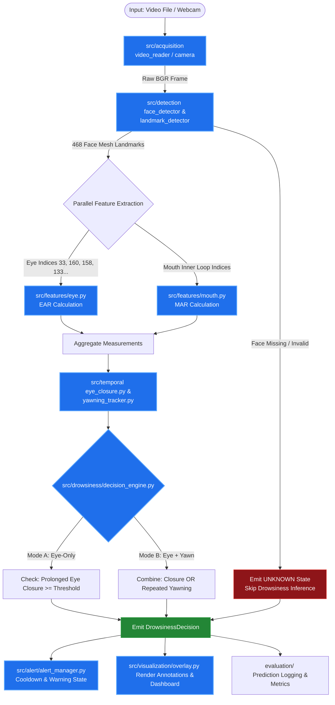

<!-- Ở đây sẽ viết các quy trình tiêu chuẩn ràng buộc cho AI Agent -->

# **AGENTS.md — Supreme Constitution of the Driver Drowsiness Detection System**

This document serves as the supreme operational and cognitive constitution for all autonomous AI coding agents, automated pipelines, and human contributors working within the PY_ADV_PJ_GR repository. All generated code, module interfaces, data models, and pull requests must strictly comply with the principles, contracts, and guardrails established herein.

Repository: https://github.com/Duy-DS/PY_ADV_PJ_GR

Topic: Image Processing & Computer Vision (Python Advanced)

> **Cross-Reference**: Functional requirements trace back to docs/project/PROJECT_DOCUMENTATION.md and pipeline designs in docs/architecture/.

---

## **🧠 1. GLOBAL PIPELINE STATE MATRIX**

Data flowing across pipeline stages must adhere to the typed definitions below. No untyped dictionaries or loose tuples are allowed between architectural boundaries.

| Field | Type | Stage / Module Owner | Description & Invariant Rule |
| :--- | :--- | :--- | :--- |
| `frame_id` | `int` | Acquisition | Zero-based incremental frame index. |
| `timestamp` | `float` | Acquisition | Realtime epoch or video relative timestamp in seconds. |
| `raw_frame` | `np.ndarray` | Acquisition | BGR video frame matrix ($H \times W \times C$). |
| `face_detected` | `bool` | Detection | True if driver's face is locked; False triggers UNKNOWN. |
| `landmarks` | `Optional[FacialLandmarks]` | Detection | 468/478 normalized/pixel coordinates from MediaPipe Face Mesh. |
| `eye_state` | `EyeMeasurement` | Features (Eye) | Bilateral EAR and instantaneous state: OPEN, CLOSED, UNKNOWN. |
| `mouth_state` | `MouthMeasurement` | Features (Mouth) | MAR and instantaneous state: MOUTH_OPEN, MOUTH_CLOSED, UNKNOWN. |
| `temporal` | `TemporalBehaviorState` | Temporal | State accumulation: closure duration, blink counter, yawn tracking. |
| `decision` | `DrowsinessDecision` | Drowsiness | State verdict: NON_DROWSY, DROWSY, UNKNOWN (Mode A or B). |
| `alert` | `AlertVerdict` | Alert | Warning trigger: NORMAL, WARNING with cooldown logic. |

---

## **🧬 2. DATA SCHEMA SPECIFICATIONS (Pydantic v2 Contracts)**

All data exchange between packages in src/ must be validated against these strict Pydantic models to guarantee reproducibility and prevent runtime type corruption.

```python
from typing import List, Tuple, Literal, Optional, Dict
from pydantic import BaseModel, Field


class FacialLandmarks(BaseModel):
    """Output contract of landmark_detector.py (WP04)."""
    face_detected: bool
    left_eye_points: List[Tuple[float, float]] = Field(default_factory=list)
    right_eye_points: List[Tuple[float, float]] = Field(default_factory=list)
    inner_mouth_points: List[Tuple[float, float]] = Field(default_factory=list)
    confidence: float = Field(default=0.0, ge=0.0, le=1.0)


class EyeMeasurement(BaseModel):
    """Output contract of eye.py (WP05 / FReq005, FReq007)."""
    left_ear: float = Field(..., ge=0.0)
    right_ear: float = Field(..., ge=0.0)
    avg_ear: float = Field(..., ge=0.0)
    eye_state: Literal["OPEN", "CLOSED", "UNKNOWN"]
    is_valid: bool = True


class MouthMeasurement(BaseModel):
    """Output contract of mouth.py (WP06 / FReq006, FReq010)."""
    mar: float = Field(..., ge=0.0)
    mouth_state: Literal["MOUTH_OPEN", "MOUTH_CLOSED", "UNKNOWN"]
    is_valid: bool = True


class TemporalBehaviorState(BaseModel):
    """Output contract of temporal_analyzer.py (WP07 / FReq008, FReq011-015)."""
    eye_closed_duration: float = Field(default=0.0, ge=0.0)
    consecutive_closed_frames: int = Field(default=0, ge=0)
    is_prolonged_closure: bool = False
    blink_count: int = Field(default=0, ge=0)
    mouth_open_duration: float = Field(default=0.0, ge=0.0)
    yawn_count: int = Field(default=0, ge=0)
    yawn_frequency_in_window: float = Field(default=0.0, ge=0.0)
    is_yawning_event: bool = False


class DrowsinessDecision(BaseModel):
    """Output contract of decision_engine.py (WP08 / FReq016-018)."""
    state: Literal["NON_DROWSY", "DROWSY", "UNKNOWN"]
    decision_mode: Literal["eye_only", "eye_yawn"]
    confidence_score: float = Field(default=1.0, ge=0.0, le=1.0)
    trigger_reasons: List[str] = Field(default_factory=list)


class AlertVerdict(BaseModel):
    """Output contract of alert_manager.py (WP09 / FReq019-021)."""
    status: Literal["NORMAL", "WARNING"]
    visual_alert_active: bool = False
    audio_alert_active: bool = False
    cooldown_remaining: float = Field(default=0.0, ge=0.0)
```

---

## **🛡️ 3. SUPREME PRINCIPLES & SAFETY GUARDRAILS**

Three-Tier Boundary Model (Kiem soat ranh gioi 3 tang)

**Always Do (Luon luon thuc thi):**
*   **Invalid Measurement Safety (FReq004, FReq030, FReq031):** Whenever `face_detected == False` or landmarks are corrupted, immediately assign `eye_state = "UNKNOWN"`, `mouth_state = "UNKNOWN"`, and `decision.state = "UNKNOWN"`.
*   **Config Decoupling (FReq024):** All operational thresholds (`ear_threshold`, `closure_time_threshold`, `mar_threshold`, `alert_cooldown`) must be loaded from `configs/default.yaml` via `src/utils/config.py`.
*   **Graceful Exit (FReq032):** Always catch End-of-Input on video streams, flush experiment logs, and release OpenCV video captures (`cap.release()`, `cv2.destroyAllWindows()`).
*   **Linter & Formatter:** Run flake8 / black and format code according to PEP 8 standards prior to submitting commits.

**Ask First (Phai xin y kien truoc khi lam):**
*   Adding new third-party libraries outside `requirements.txt` (OpenCV, MediaPipe, NumPy, Pandas, Scikit-learn, Matplotlib, PyYAML).
*   Modifying predefined pipeline schemas or the root project folder tree.
*   Enabling deferred components (such as `head_pose.py` or complex Deep Learning classifiers) that expand project scope.

**Never Do (Tuyet doi cam):**
*   **CRITICAL RED LINE:** NEVER infer DROWSY from a missing face, corrupted landmark, or single isolated blink (Single Closed Frame != Drowsy).
*   **Data Leakage Red Line:** NEVER randomly shuffle and split extracted video frames into train/validation/test sets. All splits on D3S dataset must be segregated strictly at the subject/video level.
*   **Direct Push:** NEVER commit or push code directly to the main branch without peer review and integration testing.
*   **Hardcoding:** NEVER hardcode geometric thresholds directly inside algorithm modules (`src/features/` or `src/drowsiness/`).

---

## **🗺️ 4. ARCHITECTURAL TOPOLOGY & EXECUTION DAG**



---

## **🏢 5. COMPONENT WORK PACKAGES & OWNERSHIP MATRIX**

The project is governed by strict Work Package (WP) ownership across the 4 team members, aligning with Section 16 & 17 of project documentation:

| Member ID | Assigned Work Packages | Primary Modules & Files | Core Mission & Invariants |
| :--- | :--- | :--- | :--- |
| **Member A (Data & Acquisition)** | WP02, WP03 | `scripts/download_dataset.py`<br>`src/acquisition/video_reader.py`<br>`src/acquisition/camera.py` | Ingest D3S video dataset without frame drops; implement accurate timestamp extraction and graceful End-of-Input stream handling (FReq001, FReq032). |
| **Member B (Detection & Mesh)** | WP04 | `src/detection/face_detector.py`<br>`src/detection/landmark_detector.py` | Integrate MediaPipe Face Mesh; extract coordinates for bilateral eye loops and inner mouth contours; set `face_detected = False` when lost (FReq003, FReq004, FReq030). |
| **Member C (Eye Branch & Utils)** | WP05, WP12 | `src/utils/geometry.py`<br>`src/features/eye.py`<br>`configs/default.yaml` | Build Euclidean geometry helpers; compute Soukupová & Čech EAR ($$\text{EAR} = \frac{\vert{}\vert{}p_2 - p_6\vert{}\vert{} + \vert{}\vert{}p_3 - p_5\vert{}\vert{}}{2 \times \vert{}\vert{}p_1 - p_4\vert{}\vert{}}$$); load `ear_threshold` dynamically. |
| **Member D (Mouth Branch & Engine)** | WP06, WP08, WP10 | `src/features/mouth.py`<br>`src/temporal/`<br>`src/drowsiness/`<br>`tests/integration/` | Compute MAR ($$\text{MAR} = \frac{\vert{}\vert{}m_2 - m_8\vert{}\vert{} + \vert{}\vert{}m_3 - m_7\vert{}\vert{} + \vert{}\vert{}m_4 - m_6\vert{}\vert{}}{2 \times \vert{}\vert{}m_1 - m_5\vert{}\vert{}}$$); track temporal events; implement Decision Engine for Experiment A vs B. |

---

## **⚙️ 6. STANDARD EXECUTION CLI COMMANDS**

All automated testing, evaluation, and interactive sessions must run through standard terminal commands:

```bash
# 1. Environment Activation
source venv/bin/activate  # On Linux/macOS
# venv\Scripts\activate   # On Windows

# 2. Dependency Verification
pip install -r requirements.txt

# 3. Running Unit Tests
pytest tests/unit/ -v

# 4. Running Integration Pipeline Test (Milestone M03 / M05)
pytest tests/integration/test_pipeline.py -v

# 5. Launching Offline Pipeline on Dataset Video (Experiment Mode A / B)
python src/main.py --source data/raw/d3s/sample.mp4 --mode eye_yawn --config configs/default.yaml

# 6. Launching Live Webcam Demo
python src/main.py --source webcam --mode eye_yawn

# 7. Automated Experiment & Metrics Evaluation (WP11)
python scripts/evaluate.py --config configs/experiment.yaml --output evaluation/results/
```

---

## **📋 7. REPOSITORY STRUCTURE & ACCESS PERMISSIONS**

AI Agents must respect the following read/write boundaries:

```text
PY_ADV_PJ_GR/
├── configs/               [READ-ONLY for agents; user configures YAMLs]
├── data/                  [READ-ONLY; raw datasets gitignored]
│   ├── raw/d3s/           [Primary benchmark dataset]
│   └── processed/         [Preprocessed landmark features]
├── docs/                  [READ & WRITE; documentation updates only]
├── evaluation/            [WRITE-ONLY; stores evaluation metrics CSVs/logs]
├── experiments/           [READ & WRITE; experiment scripts]
├── models/                [READ-ONLY; pretrained model weights if applicable]
├── notebooks/             [READ & WRITE; exploratory EDA notebooks]
├── reports/               [WRITE-ONLY; final figures, tables, and reports]
├── scripts/               [READ & WRITE; automation and data loading tools]
├── src/                   [READ & WRITE; core modular codebase]
│   ├── acquisition/       [Input stream managers]
│   ├── alert/             [Alarm & cooldown logic]
│   ├── detection/         [MediaPipe Face Mesh wrappers]
│   ├── drowsiness/        [Rule-based & decision logic]
│   ├── features/          [EAR and MAR mathematical extractors]
│   ├── pipeline/          [Offline and realtime orchestrators]
│   ├── temporal/          [State trackers for closure & yawning]
│   ├── utils/             [Config loader, geometry, timers, loggers]
│   ├── visualization/     [OpenCV HUD and annotation overlays]
│   └── main.py            [CLI entrypoint]
├── tests/                 [READ & WRITE; pytest unit and integration suites]
├── requirements.txt       [PROTECTED; require human approval to modify]
└── AGENTS.md              [SUPREME CONSTITUTION; STRICTLY PROTECTED]
```

---

## **🚨 8. COMMIT CONVENTIONS & CI/CD GATES**

**Conventional Commits:** All git commit messages generated by developers or agents must follow:
*   `feat(detection): implement MediaPipe Face Mesh landmark parser`
*   `fix(features): correct Euclidean distance formula in EAR calculation`
*   `test(temporal): add unit test for blink vs prolonged closure recovery`
*   `docs(architecture): update pipeline sequence diagram in docs`

**Pull Request Quality Gates:**
*   All unit tests under `tests/unit/` must return 100% green pass.
*   Zero linter warnings on modified files (`flake8 src/ tests/`).
*   Code must maintain existing modular boundaries without cyclical imports.