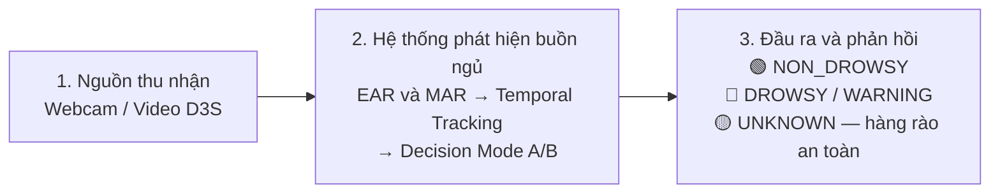
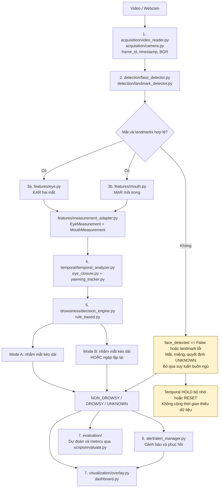
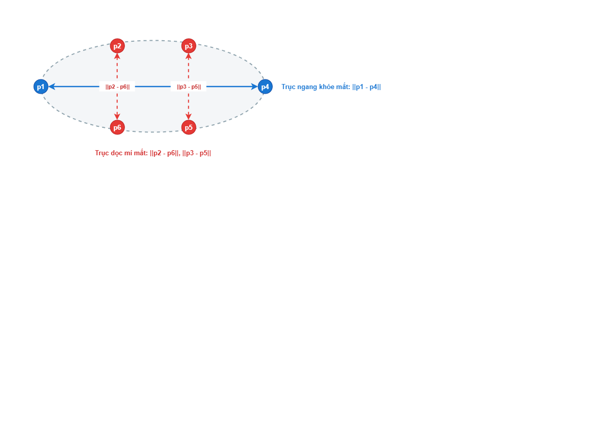
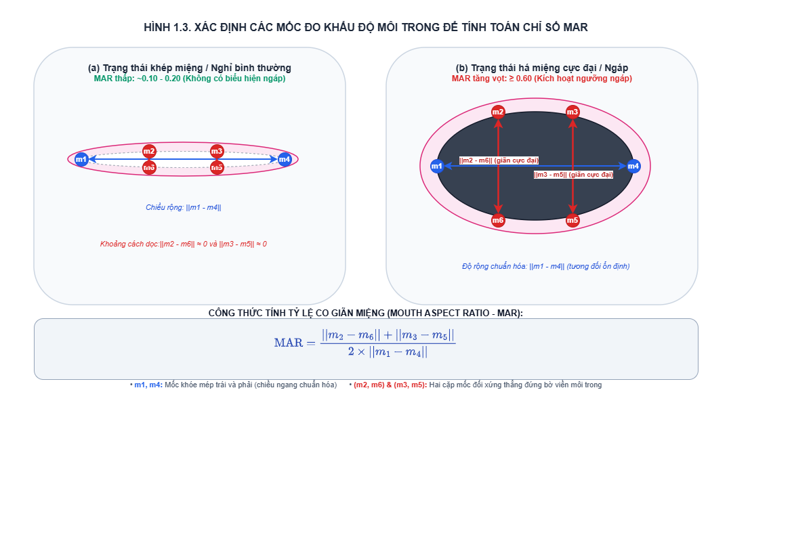
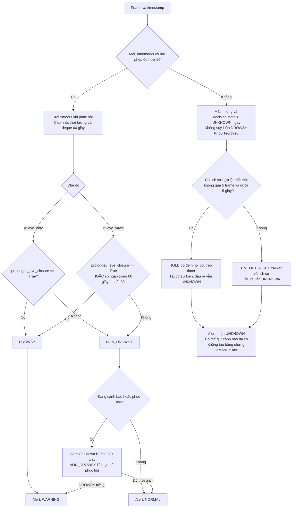

# Driver Drowsiness Detection System

> Phát hiện sớm trạng thái buồn ngủ của tài xế dựa trên phân tích đặc trưng khuôn mặt theo chuỗi thời gian.


**Điều hướng nhanh:** [Báo cáo hiện có](docs/thesis/858043_PY-ADV_BaoCaoTongKet_DriverDrowsinessDetection_Final.pdf) · [Demo và CLI](#cai-dat) · [Đánh giá](#thuc-nghiem) · [AGENTS.md](AGENTS.md)

Các đích thuộc thiết kế `reports/final_report/`, `demo/README.md`, `docs/experiments/EXPERIMENT_PLAN.md` **chưa tồn tại** trong checkout này. Điều hướng trên dùng đích thay thế đang có; không tạo thư mục chỉ để khớp một cây mẫu.

**Lộ trình:** [1. Tổng quan](#tong-quan) → [2. Kiến trúc](#kien-truc) → [3. Thuật toán](#thuat-toan) → [4. Đánh giá](#thuc-nghiem) → [5. Cấu trúc](#cau-truc) → [6. Cài đặt](#cai-dat) → [7. Phân công](#phan-cong).

> **Giới hạn:** Đây là nguyên mẫu học phần cho nhóm bốn người, không phải công cụ chẩn đoán y khoa hay hệ thống an toàn ô tô được chứng nhận. Python 3.9+ là định hướng ban đầu; mã hiện tại dùng cú pháp kiểu hợp cần Python 3.10+, và bộ phiên bản khóa trong `requirements.txt` cần được kiểm tra trên môi trường cài thực tế.

<a id="tong-quan"></a>
## 1. Tổng quan hệ thống — Cấp 1: Bối cảnh tổng quát
### Bài toán và động lực
Một khung hình mắt nhắm có thể chỉ là **chớp mắt sinh lý**, không đủ bằng chứng kết luận ngủ gật hay *microsleep*. Miệng mở có thể do nói chuyện, cười hoặc ngáp. Suy luận trực tiếp từ một phép đo EAR/MAR làm tăng nguy cơ cảnh báo sai và bỏ qua tính tích lũy của hành vi.

**Phân tích hành vi theo thời gian** kết hợp ba lớp bằng chứng: phép đo hình học hợp lệ, thời lượng liên tục và tần suất sự kiện. Dự án so sánh **Mode A (`eye_only`)** với **Mode B (`eye_yawn`)** để kiểm chứng giá trị bổ sung của ngáp; không mặc định rằng thêm đặc trưng luôn làm tăng hiệu năng.



| Hạng mục | Phạm vi |
| --- | --- |
| Đầu vào lõi | Video đọc tuần tự; ảnh/frame hỗ trợ khảo sát và đánh giá có giới hạn. Webcam có đường chạy demo. |
| Điều kiện quan sát | Một tài xế, khuôn mặt đủ rõ, tương đối chính diện, ánh sáng thông thường. |
| Trạng thái suy luận | `NON_DROWSY`, `DROWSY`, `UNKNOWN`; kèm phép đo, hành vi và lý do. |
| Trạng thái cảnh báo | `NORMAL`, `WARNING`, `COOLDOWN`; độc lập với nhãn suy luận. |
| Ngoài lõi | Head pose và ML/DL bổ sung được hoãn; không tích hợp ECU hay điều khiển xe. Độ bền trong thiếu sáng/kính/góc nghiêng cần kiểm chứng riêng. |

> **Vị trí ảnh HUD tổng quan:** Chưa có `demo/images/` hoặc ảnh HUD độc lập được xác nhận trong đó. Đây là chỗ dành cho ảnh chụp demo thực tế khi nhóm cung cấp; không dùng ảnh khuôn mặt dataset thay cho bằng chứng giao diện. HUD do `src/visualization/overlay.py` và `dashboard.py` phụ trách.

<a id="kien-truc"></a>
## 2. Kiến trúc luồng xử lý chi tiết — Cấp 2: Pipeline bảy tầng
**Luồng chính:** Input Acquisition → Face & Landmark Detection → Feature Extraction (EAR & MAR) → Temporal Behavior Analysis → Decision Engine (Mode A/B) → Alert & Recovery Manager → Visualization & Logging.

Không có `reports/figures/` trong checkout. Hình bảy tầng đã có ở `docs/slides/` và được tham chiếu nguyên vị trí:




Mắt và miệng **song song về phân rã kiến trúc**, không hàm ý chạy đa luồng. `src/pipeline/realtime_pipeline.py` điều phối webcam **và video** qua CLI; `offline_pipeline.py` phục vụ chuỗi ảnh đánh giá.

### Ánh xạ module và hợp đồng dữ liệu
| Tầng | Module hiện có | Đầu vào | Đầu ra / mức triển khai |
| --- | --- | --- | --- |
| 1. Thu nhận | `src/acquisition/video_reader.py`, `src/acquisition/camera.py` | Đường dẫn video / chỉ số camera | Hiện trả bộ `(frame_id, timestamp, raw_frame)`; BGR `np.ndarray`, thời gian giây. |
| 2. Mặt và mốc | `src/detection/face_detector.py`, `src/detection/landmark_detector.py` | Frame BGR | Hợp đồng đích `FacialLandmarks`; hiện là dictionary cờ/bbox/điểm, mô tả bằng `TypedDict` trong pipeline. |
| 3. Đặc trưng | `src/features/eye.py`, `src/features/mouth.py`, `src/features/measurement_adapter.py` | Tọa độ pixel mắt/môi | `EyeMeasurement`, `MouthMeasurement` Pydantic v2 có `is_valid`. |
| 4. Temporal | `src/temporal/eye_closure.py`, `src/temporal/yawning_tracker.py`, `src/temporal/temporal_analyzer.py` | Phép đo typed, timestamp, cờ mặt | `TemporalBehaviorState` trong `TemporalAnalysisResult`: thời lượng, bộ đếm, cờ, `CONTINUE/HOLD/RESET`. |
| 5. Quyết định | `src/drowsiness/decision_engine.py`, `src/drowsiness/rule_based.py` | Snapshot temporal qua `model_dump()` | Hợp đồng đích `DrowsinessDecision`; hiện là dictionary `state/reason`, kiểu `DecisionResult` trong pipeline. |
| 6. Cảnh báo | `src/alert/alert_manager.py`, `src/alert/alarm.py` | Quyết định và thời gian | Hợp đồng đích `AlertVerdict`; hiện là enum `AlertState` gồm `NORMAL/WARNING/COOLDOWN`. |
| 7. Hiển thị và log | `src/visualization/overlay.py`, `src/visualization/dashboard.py`, `src/pipeline/offline_pipeline.py`; consumer `scripts/evaluate.py` | Frame, phép đo, hành vi, quyết định, cảnh báo | HUD; `FrameResult`/`ExecutionSummary`; DataFrame/CSV trong `evaluation/`. Không tác động ngược đến suy luận. |

Pydantic hiện có ở [src/utils/contracts.py](src/utils/contracts.py). `FacialLandmarks`, `DrowsinessDecision`, `AlertVerdict` là **hợp đồng đích trong [AGENTS.md](AGENTS.md)**, chưa phải các lớp đã khai báo trong tệp này. Sơ đồ không khẳng định mọi ranh giới đã chuyển hoàn toàn sang Pydantic.

<a id="thuat-toan"></a>
## 3. Cơ chế trọng tâm và thuật toán cốt lõi — Cấp 3: Phân tích sâu
### 3.1. Đặc trưng hình học cấp khung hình: EAR và MAR
Với sáu điểm theo thứ tự quanh mắt hoặc đường môi, công thức hai khoảng cách dọc là:

$$
\text{EAR} = \frac{\|p_2 - p_6\| + \|p_3 - p_5\|}{2 \times \|p_1 - p_4\|} \qquad ; \qquad \text{MAR} = \frac{\|m_2 - m_6\| + \|m_3 - m_5\|}{2 \times \|m_1 - m_4\|}
$$

Chuẩn Euclid đo trên **tọa độ pixel cùng hệ quy chiếu**, mẫu số là chiều ngang. EAR lấy trung bình hai mắt; EAR thấp gợi ý mắt nhắm, MAR cao gợi ý miệng mở, **chưa kết luận buồn ngủ**.



**Phân biệt công thức minh họa với mã thực tế:** MAR sáu điểm ở trên là biến thể tham khảo. `src/features/mouth.py` hiện nhận **tám điểm môi trong**, dùng **ba** khoảng cách dọc; ngưỡng mặc định `0.60` gắn với biến thể này:

$$
\text{MAR}_{8} = \frac{\|m_2-m_8\|+\|m_3-m_7\|+\|m_4-m_6\|}{2\times\|m_1-m_5\|}
$$



| Vùng | Chỉ số theo thứ tự trong `landmark_detector.py` |
| --- | --- |
| Mắt phải | `33, 160, 158, 133, 153, 144` |
| Mắt trái | `362, 385, 386, 263, 374, 373` |
| Môi trong | `78, 81, 13, 311, 308, 402, 14, 178` |

Không dùng chung ngưỡng giữa hai biến thể MAR mà chưa hiệu chuẩn. Adapter kiểm tra số điểm, tọa độ hữu hạn và chiều ngang khác không. Mặt mất hoặc landmark hỏng → **cả mắt và miệng `UNKNOWN`, `is_valid=False`**; giá trị `0.0` trong phép đo unknown không chứng minh mắt nhắm. Face Mesh có 468 mốc cơ bản; model Tasks có thể trả 478 mốc khi gồm vùng mống mắt.

### 3.2. Theo dõi thời gian và cửa sổ trượt 60 giây
**Nhắm mắt liên tục:** mặc định `EAR < 0.25` → `CLOSED`; tracker chỉ tích lũy thời gian quan sát hợp lệ và cần nhiều frame xác nhận:

$$
T_{\text{closure}} \ge 1.5\,\text{s}, \qquad \text{Single Closed Frame} \neq \text{Drowsy}.
$$

Mắt mở kết thúc chu kỳ nhắm. Khi HOLD, timer được treo; không cộng khoảng không quan sát như thời gian tiếp tục nhắm mắt.

**Ngáp hợp lệ:** $\text{MAR}_{8} \ge 0.60$ duy trì ít nhất $2.0\,\text{s}$ với nhiều quan sát. Mỗi chu kỳ mở miệng chỉ phát **một sự kiện** khi đủ thời lượng; cần đóng rồi mở lại để bắt đầu chu kỳ mới. Đây là heuristic lọc hành vi ngắn, không bảo đảm loại hoàn toàn nói chuyện hoặc cười kéo dài.

**FIFO theo timestamp:** `src/temporal/yawning_tracker.py` dùng `collections.deque`. Tại $t$, loại sự kiện đầu khi $t-t_i>60\,\text{s}$; sự kiện đúng biên 60 giây vẫn được giữ:

$$
N_{60}(t)=\left|\{t_i\mid t-60\le t_i\le t\}\right|.
$$


`TemporalBehaviorState.yawn_count` là tổng tích lũy; luật Mode B dùng **`yawn_frequency_in_window`**, tức $N_{60}(t)$. Hình gọi số trong cửa sổ là `yawn_count`; cần phân biệt tên minh họa với tên trường thực tế.

### 3.3. Quyết định Mode A/B và chịu lỗi HOLD/RESET


**Ba ranh giới an toàn:** phép đo lỗi → `UNKNOWN`; temporal không hợp lệ → bỏ qua luật; alert/HUD không viết lại quyết định. HOLD **giữ bộ nhớ**, không giữ nhãn `DROWSY` cho frame hiện tại. RESET khi số frame thiếu **lớn hơn 5** hoặc thời gian từ quan sát hợp lệ cuối **từ 1.5 giây trở lên**; chưa có lịch sử hợp lệ thì không HOLD.

- **Mode A:** `is_prolonged_closure` (ý nghĩa `prolonged_eye_closure`) đúng → `DROWSY`.
- **Mode B:** nhắm mắt kéo dài **HOẶC** $N_{60}(t)\ge3$ → `DROWSY`; `yawn_count >= 3` chỉ đúng nếu hiểu là số **trong cửa sổ**, không phải tổng tích lũy.
- **Cooldown 3.0 giây** là đệm **phục hồi**, không trì hoãn cảnh báo đầu tiên. `UNKNOWN` không chứng minh phục hồi: alert có thể giữ `WARNING` hoặc chuyển `COOLDOWN` về `WARNING`, trong khi quyết định vẫn `UNKNOWN`.

<a id="thuc-nghiem"></a>
## 4. Thiết lập thực nghiệm và kết quả đánh giá
### 4.1. Dữ liệu D3S và ngăn rò rỉ dữ liệu
**Driver Drowsiness Dataset (D3S)** là dữ liệu chính. Đối chiếu [kiểm kê cục bộ](data/metadata/d3s_inventory.csv), [nhãn đầu vào](data/raw/labels.csv), nguồn nhãn và thứ tự frame thật trước khi xem ảnh là chuỗi video liên tục.

1. Giữ nguyên dữ liệu thô; bảo toàn subject/video/session ID, frame index, timestamp; dữ liệu dẫn xuất để riêng.
2. **Split theo subject trước**, nếu không khả thi thì theo video/session và nêu giới hạn. **Không chia ngẫu nhiên frame lân cận** vào train/validation/test.
3. Chốt ngưỡng trên tập phát triển; so sánh hai mode trên **cùng tập kiểm thử độc lập**; không dùng luật đang đánh giá để sinh ground truth.
4. Báo cáo Accuracy, Precision, Recall, F1, FPR, latency, FPS và số/tỷ lệ `UNKNOWN`; không âm thầm loại lỗi nhận diện.

**Giới hạn hiện tại:** `scripts/evaluate.py` gom ảnh theo `subject_id/label_name`, sắp theo tên và gán timestamp **giả định 30 FPS**. Gom nhóm này không tự chứng minh cùng video/session và **không thực hiện subject-level split**. Chưa được xem là kiểm định temporal trên video thực nếu thiếu metadata. `OfflinePipeline` truyền YAML cho temporal nhưng khởi tạo detector và decision engine theo mặc định riêng; cần kiểm tra tính nhất quán cấu hình khi tái lập.

### 4.2. Tham số mặc định
Ngưỡng phải nạp từ [configs/default.yaml](configs/default.yaml) qua [src/utils/config.py](src/utils/config.py), không chép số cố định vào thuật toán.

| Khóa YAML | Giá trị | Vai trò |
| --- | --- | --- |
| `face_detection.min_detection_confidence` | `0.5` | Độ tin cậy tối thiểu phát hiện mặt. |
| `eye.ear_threshold` | `0.25` | EAR dưới ngưỡng → nhắm. |
| `eye.closure_time_threshold` | `1.5` s | Xác nhận nhắm mắt kéo dài. |
| `mouth.mar_threshold` | `0.6` | MAR tám điểm từ ngưỡng trở lên → mở miệng. |
| `mouth.yawn_duration_threshold` | `2.0` s | Thời lượng tối thiểu xác nhận ngáp. |
| `mouth.yawn_frequency_window` | `60.0` s | Cửa sổ FIFO. |
| `mouth.yawn_frequency_threshold` | `3.0` | Số sự kiện tối thiểu trong cửa sổ. |
| `alert.cooldown` | `3.0` s | Đệm phục hồi; tên khóa thực tế là `cooldown`. |
| `temporal.missing_face_tolerance_frames` | `5` | Giới hạn frame để HOLD. |
| `temporal.missing_face_timeout_sec` | `1.5` s | Chạm timeout phải RESET. |
| `alert.sound_enabled` | `true` | Bật cấu hình âm thanh; còn phụ thuộc backend. |
| `drowsiness.mode` | `eye_yawn` | Mode mặc định, CLI có thể chọn lại. |

[configs/experiment.yaml](configs/experiment.yaml) dùng EAR `0.22`, closure `1.2 s`, MAR `0.55`, yawn duration `1.5 s`, **khác mặc định**. Mỗi kết quả phải gắn đúng cấu hình thực sự được áp dụng.

### 4.3. So sánh định lượng và mức độ bằng chứng
Bảng sau **trích bảng đối sánh trong [báo cáo tổng kết hiện có](docs/thesis/858043_PY-ADV_BaoCaoTongKet_DriverDrowsinessDetection_Final.docx)**, không phải phép đo mới trong lần sửa README:

| Chỉ số | Mode A — Eye-only | Mode B — Eye + Yawn | Diễn giải |
| --- | --- | --- | --- |
| Accuracy | 70.74% | 70.74% | Chưa có chênh lệch trong bảng nguồn. |
| Precision | 92.39% | 92.39% | Độ tin cậy dự đoán buồn ngủ. |
| Recall | 55.53% | 55.53% | **Chưa chứng minh Mode B vượt Mode A.** |
| F1-score | 0.6937 | 0.6937 | **Chưa chứng minh lợi ích thêm ngáp.** |
| FPS CPU end-to-end | Chưa xác minh | Chưa xác minh | Mốc **khoảng 25–26 FPS** cần benchmark tái lập, không phải kết quả đã đạt. |

**Xung đột nguồn cần xử lý:** diễn giải báo cáo kỳ vọng Mode B tăng Recall/F1, nhưng bảng ghi hai mode bằng nhau. Phụ lục ghi ma trận `TN=501, FP=31, FN=298, TP=489` cho cả hai mode, **không khớp** Recall/F1 của bảng. Phụ lục timing ghi `49.6/50.1 FPS` từ latency suy luận `20.14/19.97 ms`, không đồng nghĩa throughput toàn pipeline có HUD/camera. Không chọn tùy ý một nhóm số liệu làm kết quả đã xác nhận.

**Kế hoạch xác minh:** đối soát nhãn/dự đoán, split độc lập, tính lại metrics và `UNKNOWN`; đo cùng CPU, độ phân giải, model, cấu hình và video, ghi rõ warm-up, I/O và HUD. Giả thuyết Mode B tăng Recall/F1 cần được kiểm định, không sửa số liệu cho phù hợp giả thuyết. `generate_robustness_report()` trong script đánh giá hiện **mô phỏng suy giảm bằng hệ số nhân**; không dùng các số đó như kết quả đo thật trong thiếu sáng/kính/góc nghiêng.

<a id="cau-truc"></a>
## 5. Cấu trúc thư mục dự án
Cây dưới phản ánh **các tệp được Git quản lý** trong checkout; không liệt kê `.git/`, `.venv/`, cache, dữ liệu lớn bị bỏ qua và cấu hình riêng máy. `demo/`, `experiments/`, `reports/` là đích định hướng **chưa hiện hữu**, không được tạo hoặc trình bày như cây đã có.

```text
PY_ADV_PJ_GR/
├── configs/                            # Cấu hình vận hành; ngưỡng không hard-code
│   ├── default.yaml                    # Mặc định: mặt, EAR, MAR, thời gian, alert, temporal
│   └── experiment.yaml                 # Cấu hình đánh giá batch; ngưỡng tinh chỉnh khác default
├── data/                               # Dữ liệu; nội dung lớn được .gitignore bỏ qua
│   ├── alarm.wav                       # Tệp âm thanh dùng bởi cảnh báo
│   ├── metadata/d3s_inventory.csv      # Kiểm kê D3S do script tạo cho khảo sát dữ liệu
│   ├── raw/labels.csv                  # Nhãn ảnh đầu vào của quy trình đánh giá
│   └── processed/                      # Dữ liệu dẫn xuất; tách khỏi dữ liệu thô
├── deploy/                             # Chỗ dành cho đóng gói; Docker hiện mới có khung
├── docs/                               # Tài liệu kỹ thuật và học thuật
│   ├── architecture/                   # Mẫu ADR; ghi quyết định kiến trúc
│   ├── bug-fixes/                      # Báo cáo lỗi và cách khắc phục theo mã nhiệm vụ
│   ├── dev-logs/                       # Nhật ký phát triển có mốc thời gian
│   ├── features/                       # Mẫu báo cáo đặc trưng
│   ├── reports/                        # Báo cáo nhiệm vụ, bài báo tham khảo và đối chiếu yêu cầu
│   ├── slides/                         # Hình kiến trúc, EAR/MAR, cửa sổ 60 giây, quyết định
│   ├── testing/                        # Chiến lược và mẫu báo cáo kiểm thử
│   └── thesis/                         # Bản báo cáo tổng kết DOCX/PDF hiện có
├── evaluation/                         # Tạo bằng chứng định lượng; chứa kết quả, không chứa suy luận
│   ├── metrics/                        # Script metrics và biểu đồ PR/ROC/confusion hiện có
│   ├── reports/                        # Báo cáo benchmark và script hồi quy
│   └── results/                        # CSV dự đoán, đối sánh và kết quả robustness
├── models/pretrained/                  # Trọng số BlazeFace và Face Landmarker đã đóng gói
├── notebooks/                          # EDA, phân tích ngáp và so sánh thực nghiệm
├── output/                             # Chỗ ghi đầu ra; nội dung sinh ra không commit
├── prompts/                            # Prompt có mã nhiệm vụ cho quy trình agent
├── scripts/                            # Tải/kiểm kê dữ liệu, đánh giá và script chẩn đoán camera/feature
├── src/                                # Mã nguồn sản phẩm, chia theo trách nhiệm
│   ├── acquisition/                    # Tầng 1: camera.py, video_reader.py; frame có thứ tự
│   ├── detection/                      # Tầng 2: face_detector.py, landmark_detector.py; MediaPipe Tasks
│   ├── features/                       # Tầng 3: eye.py, mouth.py; measurement_adapter.py nối typed contract
│   ├── temporal/                       # Tầng 4: eye_closure.py, yawning_tracker.py, temporal_analyzer.py
│   ├── drowsiness/                     # Tầng 5: decision_engine.py, rule_based.py; diễn giải buồn ngủ
│   ├── alert/                          # Tầng 6: alert_manager.py và alarm.py; WARNING/COOLDOWN
│   ├── visualization/                  # Tầng 7: overlay.py HUD, dashboard.py; không đổi suy luận
│   ├── pipeline/                       # Điều phối realtime (webcam/video) và offline (chuỗi ảnh)
│   ├── utils/                          # config.py, geometry.py, contracts.py; hợp đồng và cấu hình chung
│   └── main.py                         # Entry point CLI và GUI launcher
├── tests/                              # pytest; unit và integration đặt tên theo Task ID
│   ├── unit/                           # Kiểm thử hình học, config, temporal, rule, alert, overlay
│   └── integration/                    # Kiểm thử end-to-end của pipeline hiện có
├── .agent/                             # Mẫu quy trình agent, không phải mã sản phẩm
├── .env.example                        # Mẫu biến môi trường, không chứa bí mật
├── AGENTS.md                           # Hiến chương kỹ thuật, yêu cầu và ranh giới an toàn
├── README.md                           # Tài liệu tổng quan ba cấp này
├── pytest.ini                          # Cấu hình đường dẫn kiểm thử
├── requirements.txt                    # Phiên bản gói khóa cho môi trường cài đặt
└── virtual_enviroment.md               # Ghi chú môi trường ảo của dự án
```

Các mục `data/raw/d3s/`, dữ liệu huấn luyện hay mô hình ML/DL chưa được triển khai **không được vẽ như thư mục đã có**. `docs/architecture/`, `docs/dev-logs/`, `docs/reports/` hiện là nơi lưu tài liệu; tài liệu kiến trúc ban đầu dạng đầy đủ không đồng nghĩa với một cây thư mục bắt buộc khác.

<a id="cai-dat"></a>
## 6. Cài đặt, thực thi và kiểm chứng
### 6.1. Thiết lập môi trường
```powershell
# Windows PowerShell; Python 3.10+ khuyến nghị theo cú pháp kiểu trong mã
git clone https://github.com/Duy-DS/PY_ADV_PJ_GR.git
Set-Location PY_ADV_PJ_GR
python -m venv .venv
.\.venv\Scripts\Activate.ps1
python -m pip install --upgrade pip
pip install -r requirements.txt
```
```bash
# macOS / Linux
git clone https://github.com/Duy-DS/PY_ADV_PJ_GR.git && cd PY_ADV_PJ_GR
python -m venv .venv && source .venv/bin/activate
python -m pip install --upgrade pip
pip install -r requirements.txt
```

Mô hình `models/pretrained/blaze_face_short_range.tflite` và `face_landmarker.task` phải tồn tại trước khi chạy. Lỗi mở video/config/model phải dừng lần chạy với thông báo rõ, không tạo kết quả giả; hết nguồn hoặc nhấn thoát phải ghi hoàn tất log và giải phóng camera/cửa sổ.

### 6.2. Chạy tương tác
```bash
# Webcam: Mode B mặc định trong config là eye_yawn
python src/main.py --source webcam --mode eye_yawn --config configs/default.yaml

# Video offline: Mode A (eye_only), đường dẫn dùng tệp có thật trên máy
python src/main.py --source data/raw/d3s/sample.mp4 --mode eye_only --config configs/default.yaml

# Không truyền tham số: mở GUI launcher để chọn mode và nguồn
python src/main.py
```

Trong PowerShell, nếu cần log/dự đoán theo từng phần tử, dùng `--max-frames` qua API `RealtimePipeline.run()` hoặc callback `on_frame`; CLI `src/main.py` hiện chỉ nhận `--source/--mode/--config`. Video nguồn phải tồn tại; tên `sample.mp4` là ví dụ từ kế hoạch, không phải khẳng định tệp đã có trong checkout.

### 6.3. Đánh giá, kiểm thử và chất lượng
```bash
# Đánh giá theo labels.csv và cấu hình thực nghiệm
python scripts/evaluate.py --config configs/experiment.yaml

# Toàn bộ unit + integration test
pytest tests/ -v

# Cổng chất lượng PEP 8 trên mã đã thay đổi
flake8 src/ tests/
black --check src/ tests/
```

`scripts/evaluate.py` chỉ nhận `--config`; `batch`/`--output` trong một số tài liệu mẫu chưa được CLI này hỗ trợ. Kết quả ghi vào `evaluation/results/` theo YAML. Chưa được tuyên bố test suite xanh hoặc FPS mục tiêu khi chưa chạy trên môi trường hiện tại.

### 6.4. Ngăn xếp công nghệ
| Nhóm | Thành phần và vai trò |
| --- | --- |
| Ngôn ngữ | Python; mã dùng kiểu hợp `dict[str, Any]`, khuyến nghị 3.10+ dù nhãn định hướng 3.9+. |
| Thị giác | OpenCV (I/O, HUD), MediaPipe Tasks (BlazeFace, Face Landmarker 468 mốc). |
| Dữ liệu và hợp đồng | NumPy, Pandas, scikit-learn, Pydantic v2, PyYAML. |
| Cảnh báo và giao diện | pygame/sounddevice, Tkinter launcher, HUD OpenCV. |
| Chất lượng | pytest, flake8, black; kiểm tra trên CPU phổ thông. |
| Đo lường | Accuracy, Precision, Recall, F1, FPR, latency, FPS, tỷ lệ `UNKNOWN`. |

<a id="phan-cong"></a>
## 7. Phân công bốn thành viên theo Work Package
Bảng dưới dựa trên phân công truy vết trong `docs/thesis/` và nhận diện nhiệm vụ trong tài liệu phát triển; đây là **bản đồ trách nhiệm đang được ghi nhận**, không phải bảng chấm điểm hay mức đóng góp đã phê duyệt. Vai trò chính thức của từng mã WP phải đối chiếu sổ quản lý dự án khi bàn giao.

| Thành viên | Work Package và nhiệm vụ đang ghi nhận | Kết quả chịu trách nhiệm |
| --- | --- | --- |
| **A — Nguyễn Tấn Duy** | WP02 (T0201, T0202), WP03 (T0301), WP07 (T0704), WP10 (T1002), WP14 (T1402, T1403) | Tải/kiểm kê D3S, thu nhận video/camera, temporal coordinator, tích hợp pipeline end-to-end và báo cáo. |
| **B — Trương Tuyết Nghi** | WP12/WP05 (T1201, T0501), WP07 (T0701), WP09 (T0901), WP14 (T1401) | Geometry và EAR, theo dõi nhắm mắt, alert manager/cooldown, video demo và biên tập. |
| **C — Đinh Hoàng Phúc** | WP06 (T0601), WP07 (T0702), WP08 (T0801, T0802), WP10 (T1001) | MAR, theo dõi ngáp, rule/decision engine và kiểm thử proof of concept. |
| **D — Đinh Thái Toàn** | WP04 (T0401, T0402), WP07 (T0703), WP09 (T0902), WP11–WP13 (T1101, T1102, T1103, T1202, T1105, T1301) | Face Mesh, dung sai mất mặt, HUD, thực nghiệm, robustness và chuẩn hóa đánh giá. |

WP01 và phần đóng gói/tài liệu chưa có tên người phụ trách rõ trong các tài liệu đã kiểm tra được **để trống có chủ đích**. Mọi thay đổi mã phải qua review, theo [AGENTS.md](AGENTS.md); không push trực tiếp lên `main`.

## Trạng thái và giới hạn kỹ thuật
| Trạng thái suy luận | Quy ước |
| --- | --- |
| `NON_DROWSY` | Frame hợp lệ nhưng chưa đủ bằng chứng buồn ngủ. |
| `DROWSY` | Đủ bằng chứng temporal theo Mode A hoặc B; mới kích hoạt cảnh báo. |
| `UNKNOWN` | Thiếu mặt/landmark/hai phép đo; bỏ qua suy luận và ghi nhận để đánh giá. |

**Giới hạn minh bạch:** ngưỡng tĩnh theo MRL/EAR chưa tự cá nhân hóa; Face Mesh dễ suy giảm trong tối, kính dày hoặc góc nghiêng lớn; HUD và video demo phải được kiểm tra trực tiếp. Nói cách khác, hệ thống chỉ cảnh báo khi có bằng chứng temporal hợp lệ, chứ không biến frame `UNKNOWN` hay một chớp mắt thành `DROWSY`.
